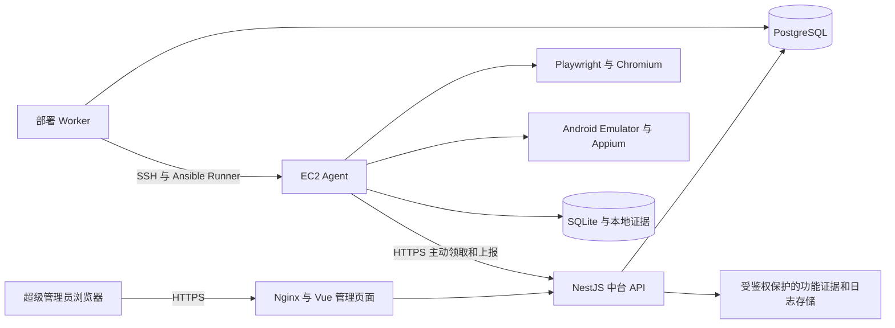

# APK 测试部署中台实施方案

1.13 增加 APP 启动停留 1/2 路并发与每日共享额度，见 [并发契约](V113_CONCURRENCY_CONTRACT.md)，对应 Agent 0.11.0。下载与部署仍整台互斥，完成数和尝试上限由两路共享。

1.12 新任务默认使用 APK 启动、前台停留 10 秒和清理，完成轮数不代表注册账户，见 [启动停留契约](V112_APP_OPEN_CONTRACT.md)，对应 Agent 0.10.0。旧注册历史保持原有含义。

1.11.2 原生弹层返回关闭遵循 [增量契约](V1112_MODAL_CONTRACT.md)，对应 Agent 0.9.2。

1.11.1 页面切换读取和启动加载识别遵循 [读取增量契约](V1111_READ_CONTRACT.md)，对应 Agent 0.9.1。

1.11 APP 启动准备与关闭确认见 [增量契约](V111_CONTRACT.md)，对应 Agent 0.9.0。

1.10.1 的控件、子框架和源码 APK 地址发现见 [下载增量契约](V1101_DOWNLOAD_CONTRACT.md)，对应 Agent 0.8.1。

1.10 默认内容隔离与真实功能测试见 [增量契约](V110_CONTRACT.md)，对应 Agent 0.8.0。原始画面不作为新执行证据上传或展示。

1.9.2 导航站跳过、注册入口修正与自动身份独立观察见 [增量契约](V192_CONTRACT.md)，对应 Agent 0.7.2。

1.9.1 的安卓版本一致性和复杂页面读取修正见 [实测修正契约](V191_CONTRACT.md)，对应 Agent 0.7.1。

1.9 安卓网页、APP 广告公告处理与页面读取遵循 [1.9 契约](V19_CONTRACT.md)，对应 Agent 0.7.0。

1.8.1 显式下载复跑规则见 [补充契约](V181_CONTRACT.md)；普通开始仍每日复用，不自动重下。

1.8 统一任务、开始停止与历史版本管理遵循 [1.8 契约](V18_CONTRACT.md)，兼容现有 Agent 0.6.0。

1.7 中台结果、中文日志、数据库汇总、历史回填与页面操作遵循 [1.7 契约](V17_CONTRACT.md)，操作见 [使用说明](V17_SETUP.md)。兼容 Agent 0.6.0，不改变注册提交及未知结果规则。

版本：1.13.0。生效日期：2026 年 10 月 30 日。实现语言基线：Node.js + TypeScript。P0/P1/P2 已验收。P3 实现和验收遵循 [安卓注册契约](P3_CONTRACT.md)，网页手机屏幕见 [1.4.1 增量](MOBILE_SCREEN_CONTRACT.md)，发布、EC2 自有测试 APK 与真实产品注册分别记录验证范围。

中台统一管理服务器、部署、测试配置和结果。执行节点运行浏览器和安卓环境。管理员不需要逐台登录 EC2 修改业务配置。

最新确认的下一版需求见 [每日下载与注册配额需求](DAILY_DOWNLOAD_AND_REGISTRATION_REQUIREMENTS.md)：每天北京时间 00:05 下载，兼容三种下载路径，新包校验后清理昨日缓存；注册复用当天 APK，所有 APK 合计成功目标 N，并设总尝试上限 M。验收只要求通过代理完成注册，画像和 App UA 采集不作为前置条件。实现规则见 [1.5 契约](V15_CONTRACT.md)，按开发与部署证据分别标记状态。

1.6 增加未配置流程 APK 的注册入口识别、节点本地图片入口 OCR、原生用户名密码表单和成功路径复用。开启需新签名发布；复杂或不确定页面结束批次等待适配，提交未知仍暂停。实现和边界见 [1.6 契约](V16_CONTRACT.md)。

## 产品范围

第一版提供一个超级管理员账户、多台手动录入的 EC2 节点、SSH 密钥或密码连接、环境检查、一键部署和升级。每个测试批次选择一个节点；节点清单可有多台，分别建立批次即可并行使用。第一版不把同一个批次自动复制到多台节点，后续再增加分摊和复制策略。

1.5 中，管理员填写网站 URL、XPath、落地页规则、代理引用、手机配置和按包名配置的注册流程。DOWNLOAD 按日只创建一次下载任务；REGISTER 复用当天已校验资产，所有 APK 合计成功目标 N、尝试上限 M；PROXY_CHECK 单独检查代理，不打开产品。每日计划默认北京时间 00:05，由管理员手动开启或关闭；计划关闭、跨日和未知结果均遵循独占节点及清理回执。网页与 APK 操作全程使用手机屏幕。旧版单次批次继续兼容。

同一个节点同一天成功下载的同一个入口复用缓存；第二天重新下载。失败允许有限重试。新建批次可能再次注册新账户，界面必须明确显示这一行为；一次 HTTP 请求的网络重试不能创建第二个批次。

新账户用户名为 6–10 位小写 ASCII 字母，以密码学随机选取的姓氏和拼音名组合生成；密码为 8–12 位 ASCII 英文字母和数字，必须同时包含两类字符。在输入前加密保存，供结果查询及不确定提交核验，已持久化账户不因升级重新生成。

## 系统部署结构



中台先部署在 Hostinger KVM 8 或普通 Ubuntu 服务器。它不运行安卓模拟器，不要求嵌套虚拟化。PostgreSQL、中台 API、部署 Worker、Nginx 使用 Docker Compose，数据目录持久化。宿主机不挂载 Docker socket 给业务容器。

EC2 接受 Ubuntu 24.04 / 26.04 LTS x86_64，平台规则见 [兼容契约](UBUNTU_COMPATIBILITY.md)，在部署时实际验证 /dev/kvm 访问和模拟器加速能力。仅型号名称不能证明环境可用。Agent、浏览器、Android SDK 和 Appium 先直接安装在宿主机，通过 systemd 管理，不在第一版嵌套 Docker 运行安卓。

## 技术选择

| 模块           | 选择                                                              | 边界                                                 |
| -------------- | ----------------------------------------------------------------- | ---------------------------------------------------- |
| 管理页面       | Vue 3、TypeScript、Element Plus、Vite                             | 仅调用中台，不能直接 SSH 或访问 Appium               |
| 中台 API       | NestJS、TypeScript                                                | 鉴权、配置版本、任务编排、审计和结果查询             |
| 数据库         | PostgreSQL 17、Prisma                                             | 中台唯一业务事实来源，事务式分配任务                 |
| 部署 Worker    | Node.js 子进程调用 Ansible Runner CLI                             | 独立进程执行固定 Playbook，不接受任意 Shell          |
| 执行节点       | Node.js 24、TypeScript                                            | 拉取任务、本地持久化、执行和回传                     |
| 浏览器         | Playwright、Chromium                                              | 定位图标、处理跳转和下载，不走业务代理               |
| Android        | Emulator、ADB、Appium 3、UiAutomator2、固定 WebDriver HTTP 适配器 | 独立数据环境、安装启动及控件操作；不自动重发变更命令 |
| APK 分析       | Node ZIP、二进制 AndroidManifest 解析器                           | 校验结构、CRC、包名、版本和 ABI，不靠文件名判断      |
| 日志与页面事件 | 结构化 JSON、HTTPS、增量分页轮询                                  | 先写数据库，再推送，断线可补读                       |
| 节点记录       | SQLite                                                            | 保存执行状态、提交记录和待上传队列                   |
| 部署与反向代理 | Docker Compose、Nginx、systemd                                    | 中台容器化，安卓节点使用宿主机服务                   |

Python 仅作为 Ansible 的运行依赖，不承载自研业务服务。第一版不引入 Redis、Kubernetes、微服务集群、AWS 自动创建实例或自动扩缩容。

软件具体版本由 package-lock.json、镜像摘要和发布清单锁定。Node.js 24、PostgreSQL 17、Appium 3 是主版本基线；不能在生产部署脚本中使用未固定的 latest。Android 镜像、Java、UiAutomator2 版本及其组合在安卓验收阶段固定。

## 模块职责

| 模块           | 输入                          | 输出与责任                       |
| -------------- | ----------------------------- | -------------------------------- |
| auth           | 管理员凭据                    | 安全会话、权限和操作审计         |
| nodes          | 地址、SSH 连接及主机指纹      | 节点资产、连接和就绪状态         |
| deployments    | 节点 ID、固定发布 ID          | 独立部署任务、步骤日志和部署结果 |
| configurations | Schema 校验后的配置、凭据引用 | 不可变配置版本及非敏感摘要       |
| runs           | 配置版本、节点、幂等键        | 批次、节点锁、执行状态及停止意图 |
| evidence       | 节点上报                      | 受限功能证据、日志、结果和加密账户数据   |
| agent          | 固定任务快照、节点凭据        | 单节点串行执行、心跳与结果补传   |
| automation     | 下载目标、设备配置、注册流程  | 各阶段结果，不直接操作中台数据库 |

HTTP 接口、部署 Worker 和 Agent 分别运行。中台进程不等待远程安装结束，也不直接启动本机安卓。节点不能访问中台数据库或其他节点的凭据。

## 页面与操作

服务器页面展示地址、Agent 版本、最近心跳、空闲或占用、环境检查结果和部署步骤。在线、部署完成、具备下载能力、具备安卓能力是不同维度。

测试配置页面包含 URL、XPath、落地页规则、浏览器 UA、代理引用、设备配置和注册流程。保存新版本不会改变运行中批次。HTTP 代理口令单独输入、加密保存，配置只保留固定凭据版本的引用。

任务页面选择单个节点和一个配置版本，显示批次匹配项、当前 APK 阶段、停止回执及结果。第一版通过受校验的 JSON 编辑器配置注册步骤，后续再增加可视化编排；不允许上传任意执行代码。

## 下载与安卓执行

1. 对网站进行一次任务发现，按 DOM 顺序收集全部匹配图标，保存 pid、绝对链接和来源。相同 pid 与链接的轮播副本合并；没有 pid 时使用链接和位置组合标识。超过配置上限时明确失败，不静默截断。
2. 执行时重新定位元素。点击前监听当前页下载、新页面及跳转；未知落地页按配置规则有限次点击。不能用导航失败简单等同于下载失败。
3. 先下载到临时文件，校验 APK 结构、包名和 SHA-256，再原子写入缓存。缓存命中仍核对文件指纹。失败临时文件不计为已完成。
4. 完整模式要求代理配置存在且检查通过。先准备独立安卓数据目录和代理，再安装并首次启动 App。网页与 APK 下载阶段直接联网。
5. 每个 APK 使用唯一 AVD 数据环境，硬件配置按任务顺序循环选取已配置的 profile。独立环境不能宣称具有真实手机身份；App 实际读取到的标识和 UA 按验证结果记录。
6. 先选择启用的手工注册流程；开启自动识别时，其他 APK 在有界步骤内识别注册入口和表单，仍找不到则结束批次并提示适配。关闭自动识别时继续跳过未适配 APK。收集受限功能证据后清理模拟器，继续下一个目标。
7. 每个流程只有一个明确的 submit 操作。提交前持久化提交意图，提交后只核验结果，不自动再提交。

轮询住宅代理可能按连接或请求更换出口；HTTP CONNECT 和连接复用会影响具体行为。IP 检查只证明该次检查请求的出口。不能宣称检查到的 IP 就是注册请求使用的 IP，也不宣称 HTTP 代理覆盖 UDP、DNS 或所有 App 协议。

不解密或改写任意第三方 HTTPS 请求、不绕过证书固定、不修改设备证明或模拟器检测。App 内 UA 只有在产品支持测试配置或实际验证可配置时才能标记受控；否则为未验证。真实硬件身份覆盖需要实体设备，属于后续范围。

## 结果判定

结果包含入口、包名、文件指纹、配置版本、节点和发布版本、设备配置、账户引用、每阶段状态、受限功能证据和错误码。账户密码与普通日志隔离，管理员显式查看时审计。

仅依据 App 页面成功标识时，结果证明级别是 APP_UI。系统不接管 APK 产品后台，不声称已在后台验证账户或设备数据。未适配、部分失败、结果未知必须在汇总中单独展示。

## 计划目录

```text
apps/web/                 Vue 管理页面
apps/control-api/         NestJS API
apps/deploy-worker/       部署任务处理器
apps/agent/               EC2 常驻执行端
packages/contracts/      从契约生成的类型和运行时校验
packages/automation/     Playwright、ADB 和 Appium 适配
packages/shared/         不含密钥的日志和通用工具
contracts/               接口、JSON Schema、样例
deploy/ansible/          固定安装与升级步骤
deploy/compose/          中台部署
docs/                    方案、契约、决策和验收
tests/                   跨进程和端到端验收
```

apps/web、apps/control-api、packages/contracts 和测试基础已在 P0 建立，deploy/compose 当前仅提供开发数据库。其余目录及执行能力随后续阶段实现。早期 Python 草稿作为历史内容保留，不创建新的 Python 业务实现。

## 参考依据

- [Node.js 发布状态](https://nodejs.org/en/about/previous-releases)：选择受支持的 Node.js 24 LTS。
- [NestJS 文档](https://docs.nestjs.com/)：TypeScript 后端模块、校验及 SSE。
- [Playwright 多语言说明](https://playwright.dev/docs/languages)：更换业务语言不改变浏览器核心能力。
- [Ansible Runner CLI](https://docs.ansible.com/projects/runner/en/stable/standalone/)：Node.js 通过子进程使用部署工具。
- [Appium 3 要求](https://appium.io/docs/en/3.0/guides/migrating-2-to-3/)：Node.js 与 npm 兼容要求。
- [Appium CLI](https://appium.io/docs/en/3.7/reference/cli/server/)：通过固定 WebDriver HTTP 适配器控制 Android，变更命令不自动重发。

技术路线是本项目的架构决策，不代表已经完成部署或兼容性测试。
